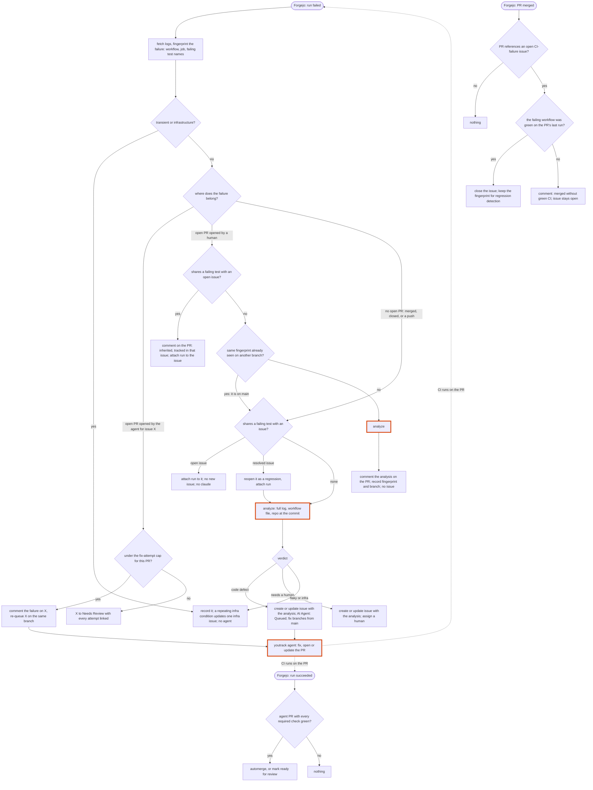

# Roadmap

Durable direction and reasoning only. Status lives in YouTrack; each item links its issue once one is filed.

## CI-failure pipeline

The current behaviour is drawn in [`ci-failure-pipeline.md`](ci-failure-pipeline.md). This section is the plan for
changing it. The epic, CLAUDE-270, carries the same proposal in YouTrack; status lives there and on each issue below.

### Tracker

Epic: CLAUDE-270.

1. CLAUDE-271: document the current pipeline and this redesign in `docs/`.
2. CLAUDE-272: a CI-failure store in the runner database (failing-test fingerprints, attached runs, agent PRs). It
   comes first because every step below reads it.
3. CLAUDE-273: dedupe by failing-test overlap, reopen a regression, always file a code failure.
4. CLAUDE-274: one analysis at ingest on a bounded worker pool, routing by its verdict.
5. CLAUDE-275: the `youtrack` action records the PR it opens and continues it when its issue is re-queued.
6. CLAUDE-276: route a failure on an open PR by who opened it.
7. CLAUDE-277: close an issue when its fix PR merges green (later superseded by CLAUDE-327: a YouTrack workflow
   resolves the issue, not the runner).
8. CLAUDE-278: automerge on the run-succeeded event instead of a polling wait.
9. CLAUDE-279: retire `ci-failure-reconcile`, the scheduled `ci-failure-analysis`, and `forgejo-ci-fix`, once their
   replacements have landed.

Related outside this repository: GAMMA-1177 (make app-server's integration suite fast enough to require).

### Problems as reported

- The same failure is reported as more than one issue.
- Integration tests kept failing without the failure reaching a fix.

### What the current process gets wrong

1. **Duplicate detection depends on YouTrack's search index and on the branch.** The mint finds an existing issue by
   full-text search for a hidden marker, so an unindexed issue is invisible. The root-cause key also includes the
   branch, so a failure every PR inherits from `main` gets one issue per PR.
2. **A resolved issue silences its failure permanently.** A later failure matching a resolved issue creates nothing:
   no issue, no comment, no reopen.
3. **With `webhook.auto_fix` off (the default), a code failure produces no issue.**
4. **Two `claude` passes, and the better one cannot route.** A tool-less classifier over a 48 KiB log decides the
   routing; the later analysis with tools over the complete log can only comment.
5. **The reason for the split is gone.** Analysis was moved to a scheduled action because run logs were not readable
   when the webhook arrived. The webhook now fetches every job's log itself.
6. **Recovery is polled, and the poll can never succeed for PR-only workflows.** Reconcile closes a code issue only when
   the job is green on `main`. `app-server`'s `integration.yml` runs on `pull_request` only (DEV-612), so its issues
   never close.
7. **The ingest consumer is serial**, so slow work added to it delays every event behind it.
8. **An agent's own failing PR is dropped.** The open-PR check suppresses it, automerge waits 300s for a suite that takes
   about 25 minutes, and `forgejo-ci-fix` is not deployed and matches its author login case-sensitively (`claude-run`
   against the real `Claude-Run`).

### Worked example: `psa-systems/app-server`, 2026-09-12

Four PRs (#760, #761, #763, #764) were each merged before their integration run finished. All four runs failed on the
same invitation tests, a defect already on `main`. Because each PR was merged, the open-PR check passed; because each
branch differs, dedupe did not match. That created GAMMA-1169, GAMMA-1170, GAMMA-1174 and GAMMA-1175, and queued four agents
on one bug, three of them against branches that no longer existed. The GAMMA-1174 agent opened PR 766 from `main`. Its
run 5874 still failed three of the tests; the webhook dropped it at the open-PR check, automerge timed out, and nothing
else acted on it. While this was being written, run 5880 on PR #765 minted and queued a fifth issue, GAMMA-1176.

### Proposed workflow

Orange-bordered steps call `claude`. Analysis runs on a bounded worker pool fed by the webhook, not inside the serial
consumer, and only for a fingerprint the runner has not seen.

CLAUDE-327 supersedes step P3 above: the runner no longer closes the issue itself. A YouTrack workflow
(`docs/yt-workflow-resolve-on-pr-merge.js`) resolves any issue whose own PR merges, so P3 is now "mark the PR's own
`agent_pull_requests` row merged; the YouTrack workflow resolves the issue". A CI-failure match against an `open`
row whose issue the workflow already resolved is read at match time and handled as step D3 (reopen as a regression),
not as a silent no-op.

### What changes

| Today                                                                                   | Proposed                                                                                               |
|-----------------------------------------------------------------------------------------|--------------------------------------------------------------------------------------------------------|
| Tool-less classifier at ingest, then `ci-failure-analysis` comments every 60s poll        | One analysis at ingest, only for a new fingerprint; its verdict routes the failure                      |
| Dedupe by YouTrack full-text search on branch-scoped markers                              | Fingerprint table in the runner's database, branch-agnostic, exact and immediate                        |
| A failure matching a resolved issue is dropped silently                                   | The issue is reopened as a regression                                                                   |
| `webhook.auto_fix` off drops code failures; the open-PR check drops them silently         | Every code defect gets an issue; a human's PR gets the analysis as a PR comment                          |
| `ci-failure-reconcile` collapses duplicates and polls for green on `main`                 | Removed: duplicates cannot form; a YouTrack workflow resolves an issue when its own PR merges (CLAUDE-327) |
| `forgejo-ci-fix` iterates on the bot's PRs, matched by login string                       | Removed: a failure on an agent PR goes back to its source issue, identified by the runner's own PR record |
| Automerge polls for 300s                                                                  | A "run succeeded" event triggers automerge                                                              |
| A PR merged before its CI finished leaves the failure on a dead branch                    | A failure with no open PR belongs to `main`, and the fix branches from `main`                           |

### Walkthrough: the worked example under the proposal

- **Run 5845 (#761, merged):** there is no open PR and the fingerprint is new. The failure is analyzed, found to be a
  code defect, and becomes one issue, queued with a fix branch from `main`.
- **Runs 5850, 5859, 5871 (#760, #763, #764, merged):** each shares failing tests with the open issue. Each run is attached
  to it. No new issue, no `claude` call, no agent.
- **Run 5874 (PR 766, the agent's fix):** the PR is the agent's, so the failure goes back to the source issue as a
  comment, and the issue is re-queued on the same branch.
- **PR 766 merges with integration green:** the issue closes. If the tests fail again later, the fingerprint reopens
  it.

One issue and one agent thread, instead of four issues, four agents, and a stuck PR.

### Decisions

1. **Fingerprints match on overlap.** A failure that shares at least one failing test with an open issue belongs to
   that issue. Which tests fail does not change the work: one failing test means the agent has something to fix, and
   the fix is done when every test passes.
2. **Fix-attempt cap on an agent PR: 3.**
3. **The integration check is not required before merge yet.** In `app-server` it takes about half an hour, which
   is too long to hold a merge on. Making it fast enough to require is tracked in GAMMA-1177. The proposal handles a PR
   merged before its CI finished either way.
4. **A human's PR always gets the analysis comment.**
