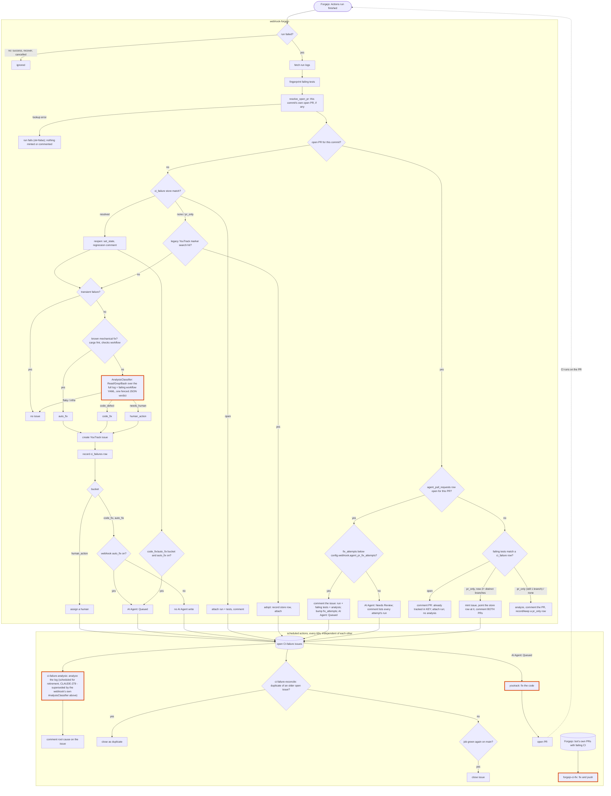

# CI-failure pipeline

How a failed Forgejo Actions run becomes YouTrack work, as the code runs today. Any change to the pipeline updates this
file in the same PR. The improvement discussion lives in [`ROADMAP.md`](ROADMAP.md#ci-failure-pipeline).

Steps with an orange border call `claude`.

## Where this lives

| Step                              | Code                                  |
|-----------------------------------|---------------------------------------|
| Webhook ingest, store dedupe, and triage | `src/web/webhooks.rs`, `src/triage.rs` |
| At-ingest analysis (`AnalysisClassifier`), shared with the scheduled action below | `src/ci_failure/analysis.rs` |
| Failing-test fingerprint and the `ci_failures` store | `src/ci_failure/fingerprint.rs`, `src/ci_failure/store.rs` |
| Gates and issue creation (no dedupe)     | `src/mint.rs`                   |
| ci-failure-analysis               | `src/native/ci_failure_analysis.rs`   |
| ci-failure-reconcile              | `src/native/ci_failure_reconcile.rs`  |
| youtrack                          | `src/native/youtrack.rs`              |
| forgejo-ci-fix                    | `src/native/forgejo_ci_fix.rs`        |
