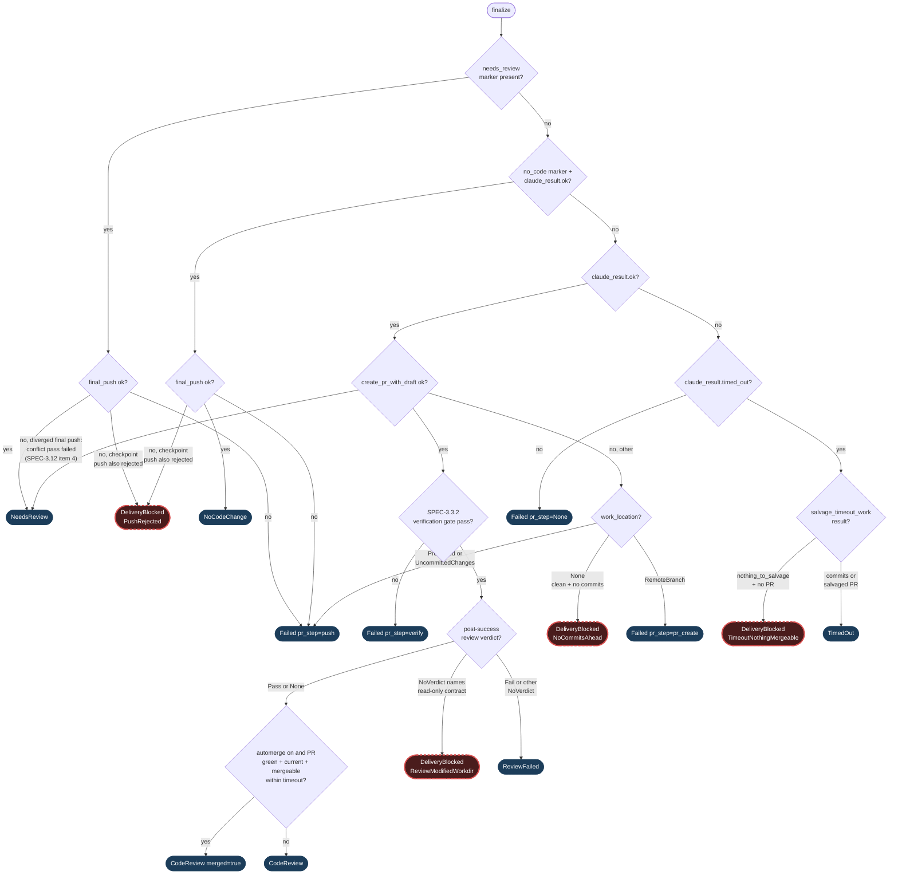

# `finalize` state machine

`src/native/youtrack.rs::finalize` runs on every path and is the only place external mutations happen (SPEC-3.3). This page is the overview a reader can glance at before opening the ~700 lines of Rust; keep it in sync when a `Finalized` variant is added, removed, or routed to a different branch (`scripts/check-claude-md.nu` enforces the variant/node count match).

The diagram separates ordinary happy-path edges (solid) from blocker edges (dashed red) so a WIP PR triage reader can see at a glance which path fired.

## Terminal states

Each terminal variant in [`Finalized`](../src/native/youtrack.rs):

- `NeedsReview`: the agent parked the job (left `.claude-run-needs-review`), OR the final push found the remote branch diverged, the local merge conflicted, and the bounded conflict-resolution pass (SPEC-3.12 item 4, `CliBackend::with_conflict_resolver`) either failed or left the merge unresolved, so the merge was aborted and the issue is parked for a human decision rather than routed through the generic push/PR-create failure path. The comment names the conflicting files and both SHAs, and names the one action the human must take, resolve the conflict by hand or re-queue the issue (SPEC-3.12 item 6). No PR in the conflict case. AI Agent = `states.needs_review`.
- `NoCodeChange`: a successful run deliberately produced no commits and left `.claude-run-no-code-change`. No PR. AI Agent = `states.no_code_label()`.
- `CodeReview { pr_url, pr_number, head_branch, merged }`: success. PR opened and promoted to ready. AI Agent = `states.code_review`. `merged` is `true` (outcome `Merged`) when automerge is enabled and the one bounded status read after promotion found the PR green, current and mergeable, so finalize merged it in the same tick (CLAUDE-549); `process_job` then marks its `agent_pull_requests` row `merged`.
- `Failed { cause, pr_step, requeued }`: a hard failure in the agent's own run or in finalize's post-agent push/PR-create/verify path. AI Agent = `states.failed` (or `states.queued` when `requeued`).
- `TimedOut { pr_number, head_branch }`: the agent hit its wall-clock limit and some work was salvaged as a draft PR (CLAUDE-379). AI Agent = `states.needs_review` when still Working, left untouched otherwise.
- `ReviewFailed { pr_url, pr_number, head_branch, requeued }`: the post-success review session (CLAUDE-449) gave a `Fail` verdict, or a `NoVerdict` that is NOT the read-only-contract case (a timeout or missing marker that survived the SPEC-3.12 item 9 retry without ever naming a workdir modification). PR stays a draft. AI Agent = `states.queued` below the attempt cap, `states.needs_review` at it. The comment names exactly one action matching `requeued`: that the issue is being re-queued for another attempt, or that it is parked at the attempt cap for a human decision (SPEC-3.12 item 6); per the SPEC-3.12 table neither case is tagged Needs-Info.
- `DeliveryBlocked { reason, pr_url, pr_number, head_branch }` (CLAUDE-545): the runner itself detected a reason the run cannot deliver a mergeable PR. One variant per reason:
  - `TimeoutNothingMergeable`: timeout with `salvage.nothing_to_salvage && salvage.pr.is_none()`.
  - `PushRejected`: a rejected checkpoint push (CLAUDE-448) followed by a failing final push.
  - `ReviewModifiedWorkdir`: a `NoVerdict` whose cause names the "read-only by contract" invariant. By the time `finalize` sees this, the review has already been retried once (SPEC-3.12 item 9, `run_review_session_with_retry` in `src/native/youtrack.rs`, called before `finalize`): a first session that modifies the workdir has its changes discarded (`discard_review_changes`) and a fresh session runs; this reason fires only when that retry also gave no verdict (another modification, a timeout, or no marker), and the cause then names both sessions' findings.
  - `NoCommitsAhead`: `create_pr_with_draft` failed with `work_location == WorkLocation::None`.
  - `CiFixCeiling`: driven by the CI-failure webhook path (`src/web/webhooks.rs`), not `finalize` itself. Included here for a complete inventory of the terminal states a run can reach, including the webhook-driven ones. Its two `Needs Review` writes (the loop-breaker that stops a repeated failure, and the hard-cap park) both name the one action and write `mint.needs_info_tag` (default `Needs-Info`), matching the SPEC-3.12 item 3 "CI remediation ceiling reached" row (CLAUDE-582).
  AI Agent = `states.delivery_blocked_label()` (falls back to `states.needs_review` when `delivery_blocked` is unset).

## Guards threaded through `finalize`

- `checkpoint_push_rejected` (CLAUDE-448): when a periodic checkpoint-push watcher's own push was rejected (typically by a pre-push hook), finalize notes the rejection in whichever outcome comment it produces AND, on the `needs_review` and `no_code` branches, promotes a subsequent final-push failure to `DeliveryBlocked::PushRejected` rather than generic `Failed`.
- `resume_pr_url`: CLAUDE-275 drives a resume onto an open PR. In the `create_pr_with_draft` error arm, a push/PR-create failure with a resume URL below the attempt cap re-queues to `states.queued` instead of parking at `states.failed`.
- Human-override preservation: the timeout path reads AI Agent before writing and leaves it untouched when a human has advanced it off Working (set Done, Code Review, ...). The delivery-blocked path on the same branch preserves this guard.
- `review`: not computed by `finalize` itself. Its caller runs `run_review_session_with_retry` (SPEC-3.12 item 9) before calling `finalize`, so a single workdir-modifying review never reaches this state machine as-is; `finalize` only ever sees the retry's own final verdict.
- Bounded conflict-resolution pass (SPEC-3.12 item 4): when the final push's local merge of a diverged `origin/<branch>` conflicts, `CliBackend::merge_remote_branch` dispatches one `claude` pass (`FinalPushConflictResolver` in `src/native/youtrack.rs`) in the same clone before falling back to aborting the merge. The pass is capped at one attempt per `create_pr_with_draft` call (`CliBackend::conflict_resolve_spent`); a second divergence in the same call, or a failed pass, aborts the merge exactly as it would with no resolver configured. On a claimed success, the resolver's own SPEC-3.3.2 verification gate run and the caller's independent re-check that no conflict markers remain gate whether the push proceeds; a failure surfaces as `Error::ConflictResolutionFailed` rather than the generic divergence error, which `finalize` routes to `NeedsReview` above instead of the `QLoc` branch.

## See also

- SPEC-3.3, SPEC-3.12 in [docs/specification.md](specification.md).
- [docs/conventions/](conventions/) for the `CLAUDE-*` convention indices the enum call sites cite.
- `finalized_outcomes_cover_every_spec_3_12_row` (`src/native/youtrack.rs` tests) exhaustively matches every `Finalized` variant, including every `DeliveryBlockedReason`, against its SPEC-3.12 item 3 table row; adding a variant without a row fails to compile.
